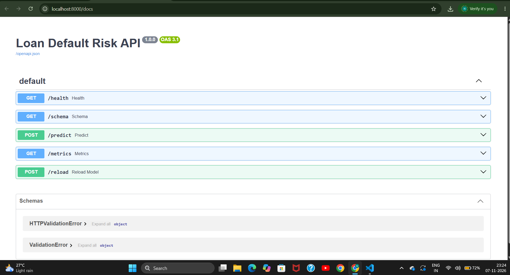
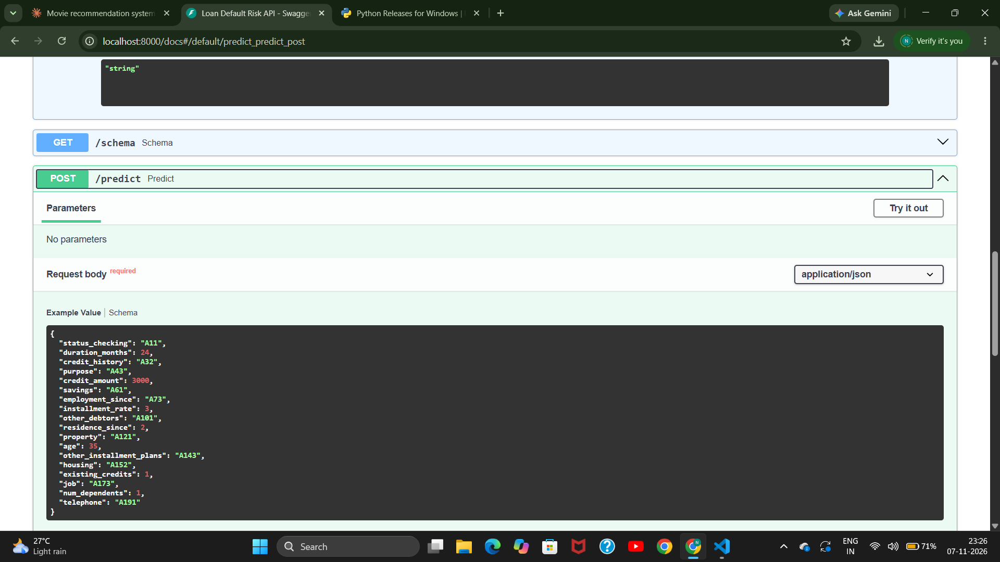
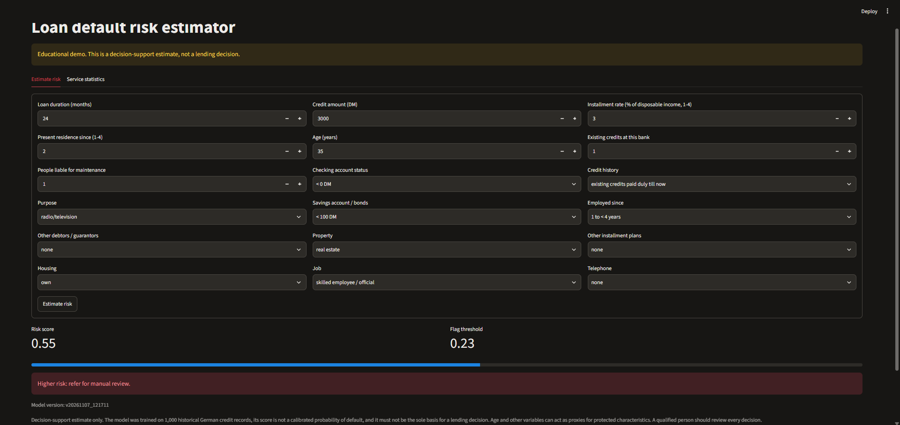
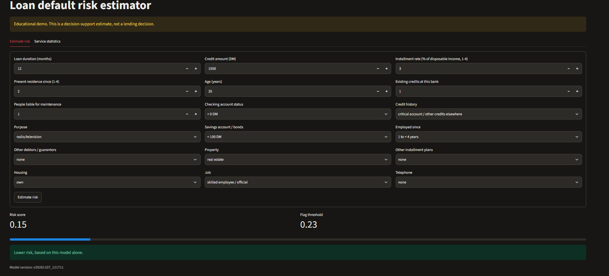
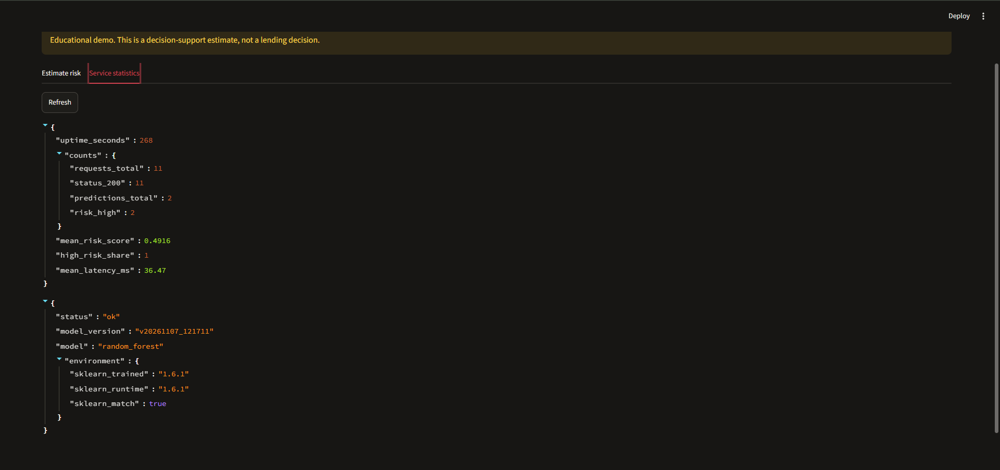
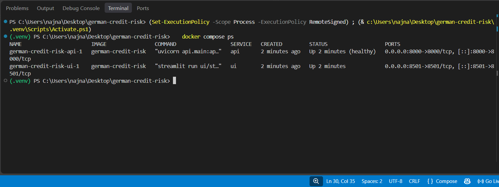
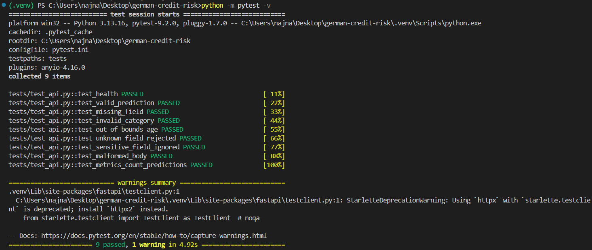
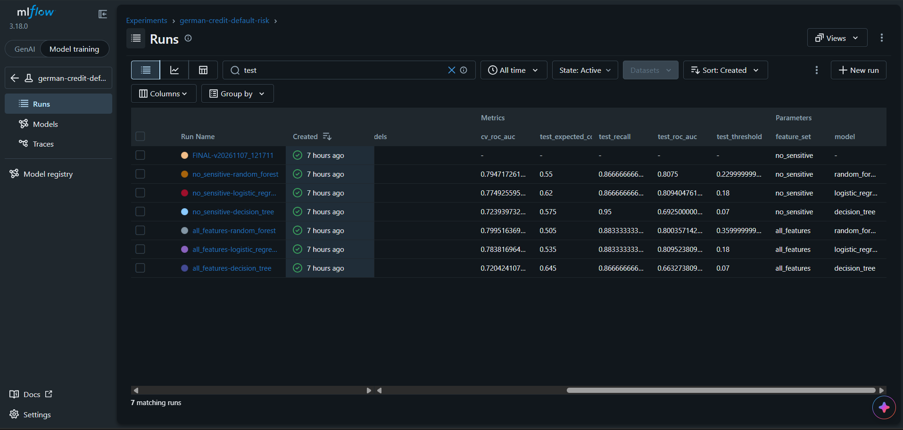

# Loan Default Risk Classification

**Author:** Najiya N
**Repository:** https://github.com/Najiya03/Loan-default-risk-classification

A reproducible machine-learning application that estimates a loan applicant's default-risk class from the UCI Statlog German Credit dataset. It includes a versioned model pipeline, a FastAPI prediction service, a Streamlit interface, Docker packaging, automated tests, request logging, and a monitoring plan.

> **Educational prototype.** The output is a decision-support estimate. It is not a calibrated probability, and it must not be the sole basis for a lending decision. See [Limitations](#limitations).

## Results at a glance

| | |
|---|---|
| Data | 1,000 applicants, 30% labelled bad (default) |
| Deployed model | Random forest, trained without personal status/sex and foreign-worker status |
| Test ROC-AUC | 0.808 |
| Recall / precision (default class) | 0.867 / 0.426 at threshold 0.23 |
| Expected cost per applicant | 0.55 (approve everyone: 1.50, reject everyone: 0.70) |

The threshold was chosen to minimise the dataset's documented cost matrix (approving a defaulter costs 5, rejecting a good applicant costs 1). The test set has only 200 rows (60 defaulters), so every metric carries wide uncertainty. 

## Project structure

```
.
├── api/
│   ├── core.py              # artifact loading, input validation, scoring
│   └── main.py              # FastAPI app, logging, request counters
├── ui/streamlit_app.py      # Streamlit form (calls the API)
├── tests/test_api.py        # 9 pytest tests
├── notebooks/
│   └── Loan_default_risk.ipynb   # data checks, EDA, training, evaluation, artifact saving
├── artifacts/
│   ├── latest.txt           # which version the API loads
│   └── v20261107_121711/    # one versioned model bundle (see below)
├── data/raw/                # german.data, german.doc (UCI)
├── docs/screenshots/        # screenshots used in this README
├── Dockerfile, docker-compose.yml, .dockerignore
├── requirements.txt         # runtime pins
├── requirements-dev.txt     # runtime + pytest, httpx
└── pytest.ini
```

## Setup (local)

Requires **Python 3.13**. The saved model was trained with Python 3.13 and scikit-learn 1.6.1, and a different scikit-learn version may fail to load it or give different results. The `/health` endpoint reports whether versions match.

```powershell
py -3.13 -m venv .venv
.venv\Scripts\activate
pip install -r requirements-dev.txt
```

On macOS/Linux use `python3.13 -m venv .venv` and `source .venv/bin/activate`.

Quick check that the model loads:

```powershell
python check_model.py
```

## Run locally

Use two terminals, both with the virtual environment active, from the project root.

```powershell
# terminal 1: API  ->  http://localhost:8000/docs
uvicorn api.main:app --reload --port 8000

# terminal 2: UI   ->  http://localhost:8501
streamlit run ui/streamlit_app.py
```

## Run with Docker

Requires Docker Desktop to be running. Stop any local API or Streamlit first, because the containers use the same ports (8000 and 8501).

```powershell
docker compose up --build     # first build takes several minutes
docker compose ps             # both services running; api should be "healthy"
docker compose down           # stop and remove
```

- API: http://localhost:8000/docs
- UI: http://localhost:8501

The `artifacts/` folder is mounted read-only into the API container, and `logs/` is mounted for the log file. A new model version therefore needs no image rebuild (see [Model refresh](#model-refresh)).

## Training and evaluation

The training and evaluation pipeline is `notebooks/Loan_default_risk.ipynb`. It was run on Google Colab, which is why its first cells mount Google Drive and upload paths are Colab paths. Adjust the paths in the first cells to run it elsewhere.

What it does, in order:

1. Loads `german.data`, decodes the column names, and records the file's SHA-256 and row count.
2. Checks for missing values, duplicates, and undocumented category codes, and prints the exploratory analysis.
3. Makes a stratified 80/20 train/test split (seed 42) and saves the indices.
4. Builds one scikit-learn pipeline (scaling and one-hot encoding inside the pipeline, so preprocessing is fitted on training folds only).
5. Tunes a decision tree, logistic regression, and random forest with 5-fold stratified grid search (ROC-AUC) on two feature sets: `all_features` and `no_sensitive`.
6. Chooses each model's decision threshold from out-of-fold training predictions using the 5:1 cost matrix, then evaluates once on the test set (precision, recall, F1, ROC-AUC, PR-AUC, confusion matrix, expected cost).
7. Computes permutation importance and a group-level fairness table.
8. Saves a new version folder under `artifacts/` and logs the runs to MLflow.

The deployed model is the random forest on `no_sensitive`, selected by lowest out-of-fold cost using training data only.

### What is in a version folder

| File | Contents |
|---|---|
| `model.joblib` | The full pipeline (preprocessing and classifier) |
| `metadata.json` | Feature order, threshold, cost matrix, Python and scikit-learn versions |
| `schema.json` | Valid category codes with labels, numeric ranges, excluded sensitive fields |
| `config.json` | Seed, split size, folds, best hyperparameters |
| `metrics.json` | Final metrics, comparison table, group fairness tables |
| `model_comparison.csv` | All six model/feature-set results |
| `data_manifest.json` | Data file name, SHA-256, row count, source |
| `split.json` | Train and test row indices |

The data hash lets you confirm that a model was trained on the file you hold:

```powershell
certutil -hashfile data\raw\german.data SHA256
```

The result should equal the `sha256` in `data_manifest.json`. A `.gitattributes` rule stops Git from changing the data file's line endings, which would alter the hash.

## API

Interactive documentation is at `/docs`.

| Endpoint | Purpose |
|---|---|
| `GET /health` | Status, loaded model version, and whether the scikit-learn version matches the training version |
| `GET /schema` | Fields, valid category codes and labels, numeric limits, threshold, notice |
| `POST /predict` | Returns a risk score and class for one applicant |
| `GET /metrics` | Request, error, and prediction counters |
| `POST /reload` | Loads a new model version without restarting (optional `?version=...`) |

### Example request (Python)

```python
import requests

applicant = {
    "status_checking": "A11", "duration_months": 24, "credit_history": "A32", "purpose": "A43",
    "credit_amount": 3000, "savings": "A61", "employment_since": "A73", "installment_rate": 3,
    "other_debtors": "A101", "residence_since": 2, "property": "A121", "age": 35,
    "other_installment_plans": "A143", "housing": "A152", "existing_credits": 1,
    "job": "A173", "num_dependents": 1, "telephone": "A191",
}
r = requests.post("http://localhost:8000/predict", json=applicant)
print(r.status_code, r.json())
```

Example response (abridged):

```json
{
  "risk_score": 0.5496,
  "risk_class": "high",
  "threshold": 0.23,
  "model_version": "v20261107_121711",
  "warnings": [],
  "ignored_fields": [],
  "notice": "Decision-support estimate only. ..."
}
```

`risk_class` is `high` when the score is at or above the threshold, otherwise `lower`. The score ranks applicants and is **not** a probability of default.

### Input validation

Invalid requests return HTTP 422 with a list of messages that name the field, and the request is counted as a validation error. Rejected cases:

- missing fields, or unknown fields
- category codes that are not in the codebook (for example `"purpose": "ZZZ"`)
- non-numeric, non-finite, out-of-range, or non-integer values (for example `"age": 5`)
- a body that is not valid JSON

Values that are valid but outside the range seen in training are accepted and return a `warnings` entry. If a client sends `personal_status_sex` or `foreign_worker`, those fields are ignored (the model does not use them) and are listed in `ignored_fields`.

## Streamlit interface

The form is built from the API's `/schema`, so its dropdowns always match the loaded model. It shows the score, the threshold, a higher/lower-risk box, any warnings, the model version, and the limitation notice. A second tab shows the service counters and health.

It needs the API to be running. Set `API_URL` to point it at a different address (Docker Compose does this automatically).

## Logging and monitoring

- **Logs:** every request is logged with method, path, status code, and latency to the console and to `logs/api.log` (rotating file). Validation failures and unhandled errors are logged. **Applicant values are never logged or stored.**
- **Counters** at `GET /metrics`: total requests, count per status code, validation errors, reload errors, predictions, higher-risk share, mean risk score, and mean latency. Counters reset when the service restarts.
- **Monitoring plan:** the evaluation report (Section 9) defines the drift and performance checks, suggested triggers, and retraining conditions. Input-drift and outcome-based checks are described but not yet implemented in the service.
- Requests for `/` and `/favicon.ico` return 404 and are counted. This is expected when a browser opens the API directly.

## Model refresh

To release a new model version:

1. Retrain with the notebook (new data, or a changed configuration). Check the new data's hash is recorded and compare the result against the current model on the same held-out data.
2. The notebook writes a new folder `artifacts/v<timestamp>/` and updates `artifacts/latest.txt`.
3. Load it into the running service, with no rebuild needed under Docker Compose:
   ```powershell
   curl.exe -X POST http://localhost:8000/reload
   ```
   Or restart the API container: `docker compose restart api`.
4. Confirm with `GET /health` that `model_version` changed and `sklearn_match` is `true`.

**Rollback:** set `artifacts/latest.txt` to the previous version folder name and call `/reload`, or call `POST /reload?version=<folder>`. If you set the `ADMIN_TOKEN` environment variable, `/reload` requires the header `x-admin-token`.

**Artifact loading:** at startup the API reads `artifacts/latest.txt` (or the `MODEL_VERSION` environment variable if set), loads `model.joblib`, `metadata.json`, and `schema.json` from that folder, and logs the version. If loading fails, the service stops with an error and does not run with a missing model. A failed `/reload` leaves the previous model in service.

## Tests

```powershell
python -m pytest -v
```

Nine tests cover health, a valid prediction, missing field, invalid category, out-of-range age, unknown field, ignored sensitive field, malformed JSON, and the prediction counter. All 9 pass.

## Screenshots

| | |
|---|---|
|  |  |
| API documentation (`/docs`) | `/predict` response |
|  |  |
| Streamlit: higher-risk result | Streamlit: lower-risk result |
|  |  |
| Service statistics tab | `docker compose ps` |
|  |  |
| pytest: 9 passed | MLflow experiment runs |

## Limitations

- **Small and dated data:** 1,000 German applicants from a past period. Results may not transfer to other populations or to today, and the 200-row test set gives wide uncertainty on every metric.
- **Selection bias:** only applicants who were granted credit have outcomes, so the model says nothing about people who were rejected.
- **Associations, not causes:** feature importance and score differences describe historical patterns.
- **Uncalibrated score:** class weighting and a tuned threshold mean the score is not a probability of default.
- **High false-rejection rate:** at the cost-optimal threshold about half of good applicants are flagged (precision 0.43), so every flagged case needs human review.
- **Fairness is only partly assessed:** personal status/sex and foreign-worker status are excluded, but proxies remain (age is the clearest). Group samples are small (for example, 6 non-foreign workers in the test set). A real deployment would need a full fairness review with legal input.
- **Scope:** no authentication, rate limiting, or audit trail. `/reload` is unprotected unless `ADMIN_TOKEN` is set.
- **Training is notebook-based:** the pipeline is reproducible (fixed seed, saved split, pinned versions) but is not yet a single command-line script.

## Data source 

UCI Statlog (German Credit Data), Prof. Dr. Hans Hofmann, Institut für Statistik und Ökonometrie, Universität Hamburg. 
